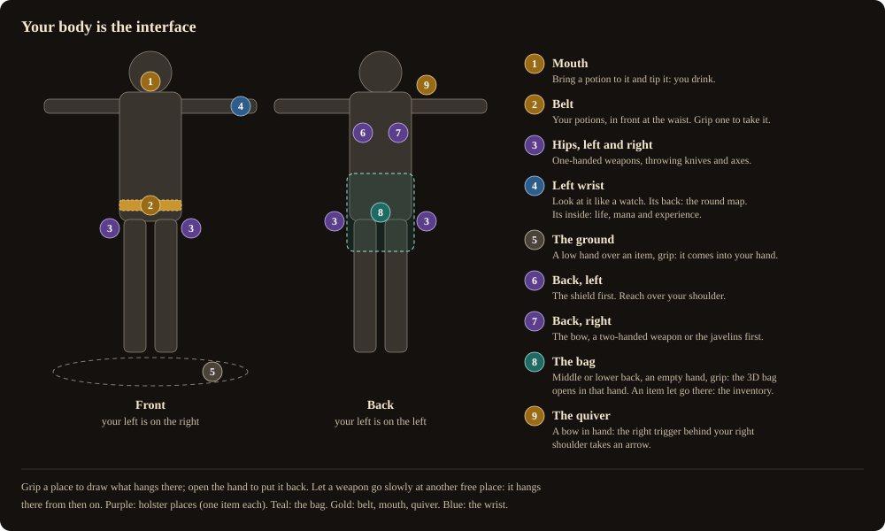
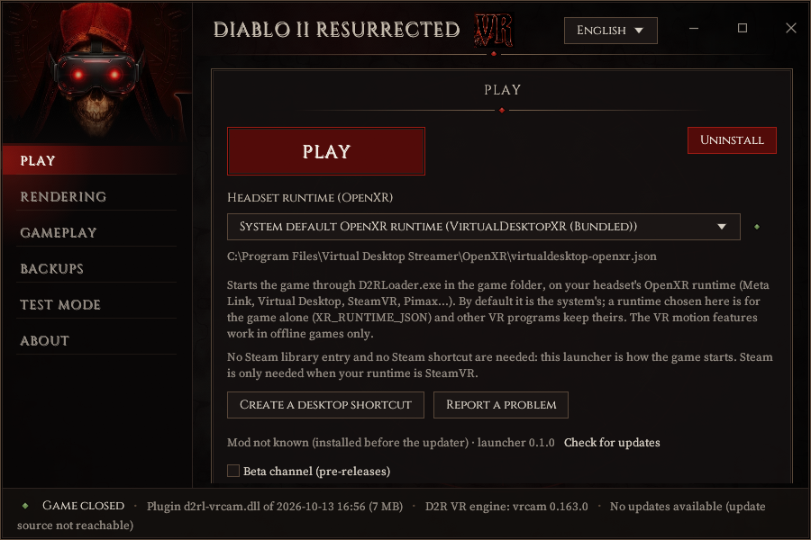

# ZVDiablo2VR

Play **Diablo II: Resurrected in virtual reality, in first person, with your hands**: swing your weapon
through the monsters, draw arrows from the quiver on your back, throw javelins, cast spells from your left
hand, hang your weapons on your body, open your inventory as a bag you hold, pick items up from the ground,
drink potions from your belt and read your life on your wrist.

**The goal: immersion, with as few menus as possible.** Your body is the interface - your weapons hang on
you, your inventory is a bag you hold, your potions are on your belt, your life and map are on your wrist,
and your skills ride your gestures. The game's own menus stay for what has no gesture yet.

> [!WARNING]
> **Work in progress - expect bugs.** ZVDiablo2VR is in active development: features change from one
> version to the next, some are not finished, and you will meet bugs (crashes, odd pictures, gestures that
> misbehave). Play on a character you do not mind losing, offline.
>
> **Thank you in advance to everyone who reports a problem** - every report makes the mod better.
> [How to report a bug](#report-a-problem): in the launcher press **Report a problem**, or open a
> [bug report](https://github.com/Ztnzvoid/ZVDiablo2VR/issues/new?template=bug.yml) /
> [crash report](https://github.com/Ztnzvoid/ZVDiablo2VR/issues/new?template=crash.yml) here on GitHub.

> **A mod, not a game.** You need your own copy of Diablo II: Resurrected. No Blizzard file is in this
> repository or in its releases: what the mod shows in your hands (weapons, quivers, potions, skill icons)
> is read from your own installation into local caches that stay on your PC.
>
> **Offline single player only.** Never use it in Battle.net games. See [Offline only](#offline-only).

## Thank you, natpoh and bearstonem

ZVDiablo2VR would not exist without two modders and their mods. Everything here stands on their work -
thank you both:

- **[D2R VR](https://github.com/natpoh/diablo2-vr-port)** by **natpoh /
  [BodyWalkVR](https://bodywalkvr.com/mods/d2r-vr)**: the VR engine - the stereo camera, first person,
  native OpenXR, the replayed right eye, the painted skies, the fog, the weapon-weight model. Support
  natpoh on [Patreon](https://www.patreon.com/c/d2vr).
- **[d2r-pcvr](https://github.com/bearstonem/d2r-pcvr)** by **bearstonem**: the gameplay base - motion
  melee, the physical bow, javelin throws, belt potions, the wrist display, the skill wheel, the VR menus
  and laser, body calibration.

If you enjoy ZVDiablo2VR, go and see their projects.

Everything is in one [D2RLoader](https://d2rloader.net/) plugin, `d2rl-vrcam.dll`, with a launcher that
installs it, starts the game in VR and edits the settings. Full credits: [Credits](#credits).

## What you can do

- **Fight with your arms**: blows land when the blade passes through a monster fast and on purpose, at the
  game's own attack pace, with the weapon's weight and vibrations. Draw the bow from the quiver behind your
  shoulder, cock the crossbow with a flick, throw javelins by opening your hand.
  [Combat](docs/guide/controls.md#combat)
- **Cast with your hands**: throw a missile, point and bring your hand down for a spell on the ground, or
  give any skill to a trigger or a button. Your weapon skills ride your blows, shots and throws. Every skill
  casts while you walk. No auto-aim anywhere. [Spells](docs/guide/features.md#skills-and-spells-on-your-gestures)
- **Wear your weapons**: both weapon sets and your shield hang at four places on your hips and back; grip a
  place to draw, open your hand to put away. [The holster](docs/guide/holster.md)
- **Hold your inventory**: reach behind your back and your inventory comes into your hand as a leather
  bag. Rummage with the other hand, read tooltips, take, put back, throw to the ground, wield, wear, use,
  identify. [The 3D bag](docs/guide/features.md#the-3d-bag)
- **Pick items up by hand**, **drink** potions from your belt at your mouth, **read your wrist** for the map
  and your life. [Controls and gestures](docs/guide/controls.md)
- **Two wheels**, one per hand, opened by a stick click: point at a skill with the other hand and it goes to
  that hand's trigger or button. [The two wheels](docs/guide/controls.md#the-two-wheels)
- **A controls screen** at the start shows your own controllers (Quest, Valve Index, Steam Frame, Pimax...),
  the places on your body and the wheels.
- Also: room-scale walking, snap or smooth turning, dialogues and game panels hung in the room, a keyboard
  in the headset, Valve Index finger tracking, the sky and fog drawn without ReShade, and the mod's own words
  in the game's language (English or French). [What the mod does](docs/guide/features.md)

**The player's guide: [docs/guide](docs/guide/README.md)** - installing, controls with pictures, every
feature, settings, performance, troubleshooting and questions.

## Requirements

- **Windows 10 or 11, 64-bit**, and a graphics card for PC VR ([Performance](docs/guide/performance.md)).
- **Diablo II: Resurrected**, your own copy (Battle.net or Steam). Tested on game build 3.3.93847; on
  another build, each feature whose game code is not recognised switches itself off and says so in the log.
- **A PC VR headset and its OpenXR runtime**: Meta Quest through Virtual Desktop or Meta Link / Air Link,
  Valve Index, Steam Frame and other SteamVR headsets, Pimax, Windows Mixed Reality.
- **An internet connection during the install**, to download D2RLoader from its official site (the
  launcher asks first).

> [!TIP]
> **Recommended: OFXR Bridge's frame generation, in 2X only.** Used alongside ZVDiablo2VR it makes the
> picture smoother and lets you keep a higher quality: the game draws about 50 frames a second and the
> headset shows 100. Use **2X only** - 3X makes the game stall. Keep `[render] xr_layers_off` empty in
> `horadrim.ini` so it loads. More in [Performance](docs/guide/performance.md#frame-generation-ofxr-bridge-2x).

## Install

> **No release yet.** The downloads will be on the
> [Releases](https://github.com/Ztnzvoid/ZVDiablo2VR/releases) page with the first release. This repository holds
> the documentation for now; the source code comes with the first release.

Download the launcher zip, unzip it, start `ZVDiablo2VR.exe` and press **INSTALL**: it installs D2RLoader
(with your consent), the mod, Microsoft's Visual C++ runtime if Windows lacks it, and builds the caches from
your own game. Choose your headset's runtime and press **PLAY**. Step by step, with pictures:
**[Installing](docs/guide/install.md)**.

**Start with a new offline character** for your first sessions: the gestures take a little practice, and
the holster, the bag and picking up move items through the game's own functions. Your saves are copied at
every start and after every save, and the launcher's **Backups** page restores them.

## Offline only

- The motion features work in **offline games only**. Everything that acts on the game (the holster, the
  bag, picking up, skills on gestures) checks in its code that the game is a local game of one player, and
  does nothing otherwise.
- **Never start the game with this mod for Battle.net play.** Third-party code in online games is against
  Blizzard's rules and puts your account at risk.
- Every game function the mod calls is recognised by its byte fingerprint first; when one does not match
  (another game build), that feature switches off and the game goes on without it.

## Known issues

- **Black squares around some lights in one eye** with the square window (`[render] vr_window = square`,
  the default): under investigation. Setting `replay_right = 0` under `[stereo]` in
  `d2rloader\plugins\d2r_vr.ini` makes them go, at a cost in frame rate.
- **Halos around smoke** and some see-through effects.
- The cave ceilings drawn without ReShade have been seen less than the sky and fog.
- A rare GPU freeze is still being tracked down; if it happens, please send a report (below).
- Using items from the 3D bag and identifying need the game's requests confirmed once
  ([Troubleshooting](docs/guide/troubleshooting.md#the-3d-bag)); a potion cannot go from the bag to the
  belt yet.
- The skills on gestures and the wheels are new; their layout may still change.

More: [Troubleshooting](docs/guide/troubleshooting.md).

## Report a problem

**Thank you for every report.** The mod is still in development, and your reports are how bugs get found and
fixed. A good report says what you were doing, what you expected, what happened, and with which headset and
runtime - and comes with the log.

**How to report, step by step:**

1. **The easiest:** in the launcher, press **Report a problem**, write what you were doing, press
   **Create the report and open GitHub**, then drag the zip it made into the GitHub page and press **Submit**.
2. **Or directly on GitHub:** open the [Issues](https://github.com/Ztnzvoid/ZVDiablo2VR/issues) tab, press
   **New issue** and pick **Bug report** (something does not work) or **Crash report** (the game closed or
   froze). Fill in the form and attach `<game folder>\d2rloader\logs\d2r-vr-frame.log` (drag the file into
   the text box).
3. **An idea instead of a bug?** Pick **Feature idea**.

Before posting, look at the [open issues](https://github.com/Ztnzvoid/ZVDiablo2VR/issues): if yours is
there, add a comment or a thumbs-up to it.

- In the launcher, **Report a problem** gathers the mod's logs, your settings and a description of the PC
  into a zip (your Windows user name replaced, never your saves) and opens the
  [crash form](https://github.com/Ztnzvoid/ZVDiablo2VR/issues/new?template=crash.yml). Say what you were
  doing and with which headset and runtime, and attach the zip.
- Otherwise, use the [bug form](https://github.com/Ztnzvoid/ZVDiablo2VR/issues/new?template=bug.yml) and
  attach `<game folder>\d2rloader\logs\d2r-vr-frame.log`.
- Never post saves, game files or account details. Security problems: [SECURITY.md](SECURITY.md).

## Building from source

The source code will be published here with the first release. For now this repository holds the
documentation.

## Credits

- **[D2R VR](https://github.com/natpoh/diablo2-vr-port)** by **natpoh / BodyWalkVR** (MIT) - the engine
  this mod runs on. If you like it, support natpoh on [Patreon](https://www.patreon.com/c/d2vr). natpoh's
  own documentation is in [his repository](https://github.com/natpoh/diablo2-vr-port), his history in
  [CHANGELOG-D2RVR.md](CHANGELOG-D2RVR.md). natpoh's own release, which runs through BodyWalk and FlatVR,
  is on [BodyWalkVR](https://bodywalkvr.com/mods/d2r-vr).
- **[d2r-pcvr](https://github.com/bearstonem/d2r-pcvr)** by **bearstonem** and its contributors (MIT) - the
  native OpenXR gameplay this mod grew from.
- **[D2RLoader](https://d2rloader.net/)** and its [Plugin SDK](https://github.com/D2RLoader/PluginSDK) (SDK:
  MIT) - the plugin host.
- MinHook, the OpenXR SDK, CascLib, pybg3, blendergranny, D2RExtractor, the LLVM-MinGW runtime, Python, the
  Cinzel and Noto Sans fonts, the Rust crates of the launcher, and Microsoft's Visual C++ redistributable:
  see [CREDITS.md](CREDITS.md) and [THIRD_PARTY.md](THIRD_PARTY.md).

What changed: [CHANGELOG.md](CHANGELOG.md).

## License

[MIT](LICENSE): copyright 2026 BodyWalkVR (D2R VR), with d2r-pcvr's and our additions under the same
license (copyright 2026 Ztnzvoid for ours). Third-party parts keep their own licenses
([THIRD_PARTY.md](THIRD_PARTY.md)). The MIT license does not cover the name "D2R VR", which is natpoh's,
nor BodyWalk and FlatVR.

Diablo II: Resurrected is a trademark of Blizzard Entertainment. This project is not affiliated with or
endorsed by Blizzard Entertainment, nor by natpoh / BodyWalkVR, bearstonem or the D2RLoader authors.
