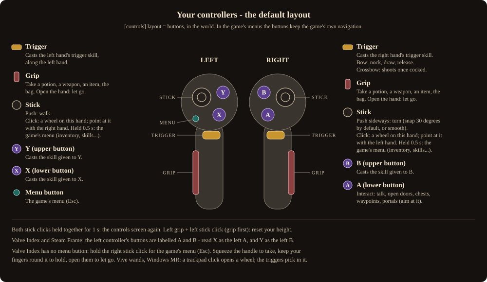
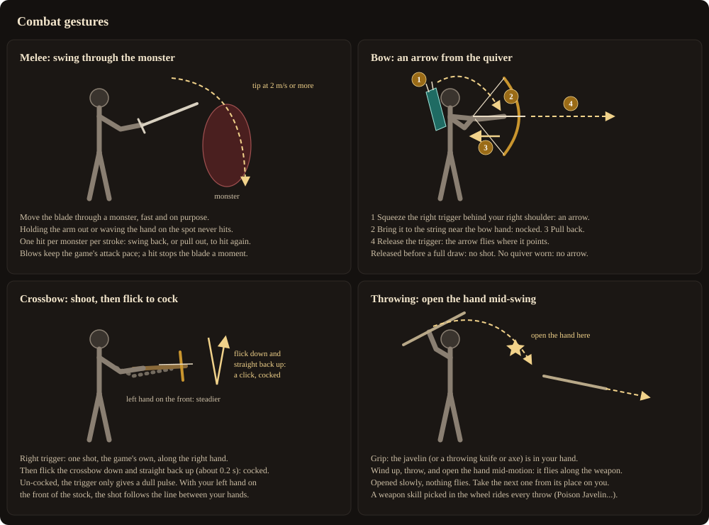
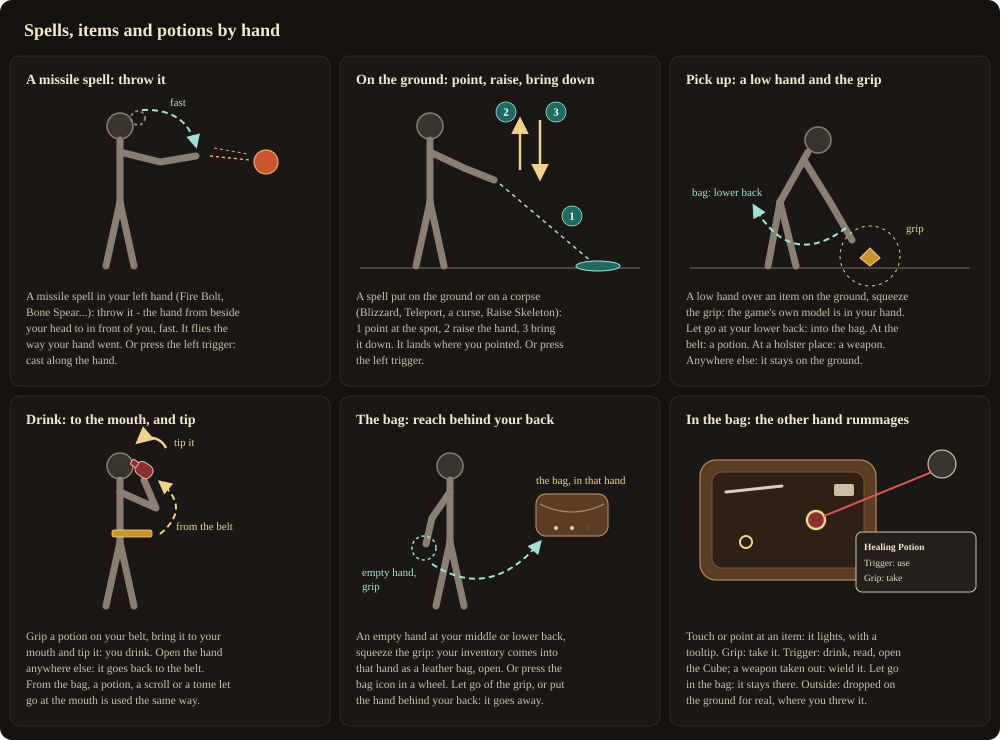
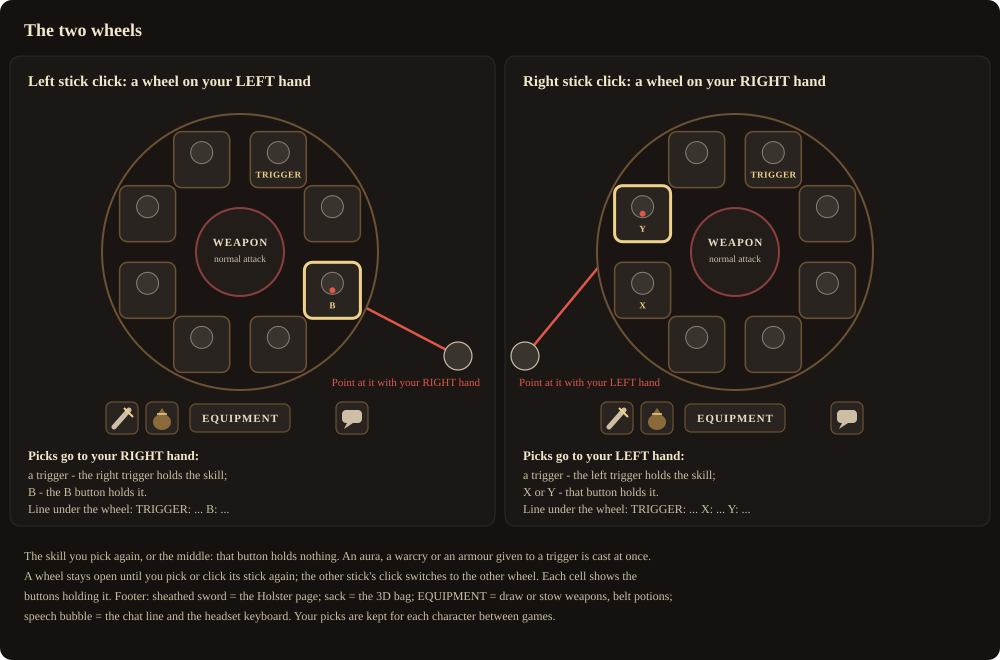

# Controls and gestures

Two tracked VR controllers; no gamepad needed. This page is the default layout, called **buttons**
(`[controls] layout = buttons` in `horadrim.ini`). The full reference, with the older **classic** layout,
the quick-cast shortcuts and every game menu prompt, is [CONTROLS.md](../../CONTROLS.md).

In the headset, the **controls screen** at each start shows the same for the controllers you actually
hold. Both stick clicks held together for a second bring it back in the game.

## The controllers

| Control | Left hand | Right hand |
|---|---|---|
| Stick | Walk | Turn (snap 30 degrees by default; smooth in the launcher's Gameplay page) |
| Stick click (short) | Opens a wheel **on the left hand**; the right hand points at it | Opens a wheel **on the right hand**; the left hand points at it |
| Stick click held 0.5 s | The game's menu tabs (inventory, character, skills, journal) | The same (Valve Index: the game's menu, Esc) |
| Trigger | Casts the left hand's trigger skill, along the left hand | Casts the right hand's trigger skill. Bow: nock, draw, release. Crossbow: shoot |
| Upper face button | **Y**: casts the skill given to Y | **B**: casts the skill given to B |
| Lower face button | **X**: casts the skill given to X | **A**: interact - talk, open doors, chests, waypoints, portals (aim at it) |
| Grip | Take: a potion, a weapon, an item, the bag. Open the hand: let go | The same |
| Menu button | The game's menu (Esc) | - |

- **Left grip + left stick click** (squeeze the grip first): reset your height.
- **Both stick clicks** held together for 1 second: the controls screen again.
- **PC keys**: F11 recenters the view; F8 saves stereo images.

### Button names on each controller

| Hand / button | Quest Touch (and Pimax) | Valve Index, Steam Frame | Vive wands, Windows MR |
|---|---|---|---|
| Left upper / lower | Y / X | **B / A** | - |
| Right upper / lower | B / A | B / A | - |
| Grip | Grip button | Index: squeeze the handle. Frame: grip | Grip button |
| Stick click | Press the thumbstick | Press the thumbstick | Trackpad click |
| Menu | Left menu button | Frame: menu button. Index: none (hold the right stick click) | Menu button |

**On Valve Index and Steam Frame, read X as the left A and Y as the left B.** The pages below say X and Y.

**Valve Index grip.** The handle senses your fingers, so a hand resting round it already reads as
closed. With Index controllers: **squeeze** the handle to take something, keep your fingers round it to
hold it (no need to keep squeezing), **open your fingers** to let go. How hard to squeeze and how far to
open: `[index] squeeze` and `release`.

**Vive wands and Windows MR**: a trackpad click opens a wheel, held it is the game's menu, and only the
triggers pick in a wheel.

## Your body

| Place | What is there |
|---|---|
| **Hips**, left and right | One-handed weapons, throwing knives and axes |
| **Upper back, left** | The shield (first choice) - reach over your shoulder |
| **Upper back, right** | The bow, a two-handed weapon or the javelins (first choice) |
| **Behind the right shoulder** | The quiver: a bow in hand, the right trigger there takes an arrow |
| **Middle or lower back** | The bag: an empty hand and the grip open the 3D bag in that hand; an item let go there goes into your inventory |
| **Belt**, front of the waist | Your potions; grip one to take it |
| **Mouth** | Bring a potion to it and tip it: you drink |
| **Left wrist** | Look at it like a watch: the round map on its back; life, mana and experience on its inside |
| **The ground** | A low hand over an item and the grip: it comes into your hand |

Grip a holster place to draw what hangs there; open the hand to put it back (hold it open about half a
second - a grip loosened in a fight does not count). Let a weapon go slowly at another free place and it
hangs there from then on. Reaching for the other weapon set's weapon swaps sets for you. Details:
[The holster](holster.md).

## Combat

- **Melee.** Move the blade through a monster, fast (its tip at 2 m/s or more) and on purpose. Holding
  your arm out, moving slowly or waving the hand on the spot never hits. Each monster is hit once a
  stroke: swing back the other way, or pull the blade out, to hit it again. Blows follow the game's own
  attack pace for the weapon; a blow that lands stops the blade a moment and vibrates by its strength.
- **Bow.** Squeeze the **right trigger behind your right shoulder**: an arrow from the quiver. Bring it to
  the string near the bow hand: nocked. Pull the right hand back, then **release the trigger**: the arrow
  flies where it points. Released before a full draw: no shot, the arrow goes back. No quiver worn: no
  arrow (a dull pulse). The quiver is put on for you when a bow is in hand and the other hand is empty.
- **Crossbow.** The **right trigger** shoots one bolt along the right hand. Then **flick the crossbow down
  and straight back up** (about 0.2 s, like working a lever): a click, it is cocked again. Un-cocked, the
  trigger only gives a dull pulse. Hold the front of the stock with your left hand (grip) and the shot
  follows the line between your hands, steadier.
- **Throwing** (javelins, throwing knives and axes). Grip: the weapon is in your hand. Wind up, throw, and
  **open the hand mid-motion**: it flies along the weapon. Opened slowly, nothing flies (that is how you
  put javelins back on your back). A grip held while striking is a thrust.

A skill picked for the weapon in a wheel rides its gesture: Magic Arrow on every arrow, Poison Javelin on
every throw, Bash or Zeal on every blow that lands. No auto-aim anywhere: every shot, throw and cast goes
where your hand points, and your hero never walks by himself.

## Spells, items and potions

- **A missile spell** in the left hand (Fire Bolt, Bone Spear, a javelin skill...): **throw it** - the
  hand from beside your head to in front of you, fast. It flies the way your hand went.
- **A spell on the ground or a corpse** (Blizzard, Teleport, a curse, Raise Skeleton): **point at the
  spot, raise the hand, bring it down**. It lands where you pointed.
- **Any skill** given to a trigger, X, Y or B: press it, and it is cast along that hand. Held, it repeats
  at the game's pace. A buff, an aura or a warcry is cast at once.
- **Casting while walking**: every skill casts while the left stick walks you, slowed, never faster than
  the game's pace.
- **Pick up**: bring a **low hand** to an item on the ground (within about 55 cm of it, the hand below
  about 95 cm) - a light tick - and **squeeze the grip**: the game's own model is in your hand. Where you
  let go decides: at your **lower back**, into the bag (the game picks it up for real); at the **belt**, a
  potion into its column; at a **holster place**, a weapon hangs there; inside the **open 3D bag**, it goes
  in where you let go; **anywhere else**, it stays on the ground. A weapon you can use comes straight into
  your hand, ready to fight. Gold is taken as soon as you touch it.
- **Drink**: grip a potion on your belt, **bring it to your mouth and tip it**. Open the hand anywhere
  else: it goes back to the belt.
- **The 3D bag**: an **empty hand behind your middle or lower back**, squeeze the grip: your inventory
  comes into that hand as a leather bag. The **other hand rummages**: touch or point at an item - it
  lights, with a tooltip; grip to take it; trigger to use it (drink, read, open the Cube, identify), or,
  for a weapon held out of the bag, to wield it. Let go inside the bag: it stays there. Outside: it falls
  or flies and is **dropped on the ground for real**. Armour let go at its place on your body is worn.
  **Let go of the bag's grip** and it goes away. All of it: [What the mod does](features.md#the-3d-bag).
- **The wrist**: turn your left wrist towards your eyes. Its back shows the map, its inside life, mana
  and experience.

The game's **A** button no longer picks items up (`[pickup] button_picks_up = no`); it still talks, opens
doors and chests, takes waypoints and portals.

## The two wheels

- **Click a stick**: a wheel opens on that hand. **Point at it with your other hand's laser.** What you
  pick goes to **the pointing hand**.
- **Right stick click** - the wheel on your right hand, your **left** hand points: press a **trigger**
  (the skill goes to your left trigger), **X** or **Y** (that button holds it).
- **Left stick click** - the wheel on your left hand, your **right** hand points: press a **trigger** (the
  right trigger) or **B**.
- Each cell shows the buttons holding it (**TRIGGER**, **X**, **Y**, **B**), and a line under the wheel
  lists the pointing hand's buttons and what each holds.
- **The middle**: the weapon's normal attack again. **The same skill again**: that button holds nothing.
- An aura, a warcry or an armour given to a trigger is cast at once; given to a button, the button casts
  it.
- Greyed cells: no mana, no button free, refused by the game a moment ago, or not an offline game.
- A wheel stays open until you pick or click its stick again; the other stick's click switches wheels.
- **The footer**: the **sheathed sword** opens the [Holster page](holster.md#the-holster-page-in-a-wheel);
  the **sack** opens the 3D bag in the hand that pressed it (pressed again: put away); **EQUIPMENT** draws
  or stows the weapons and lists the belt's potions; the **speech bubble** opens the game's chat line and
  the headset keyboard.

Each character keeps his picks between games (triggers, X, Y, B and each weapon gesture's skill), in the
mod's own files - the game's save is never touched.

## The game's menus

In the game's menus (inventory, stash, merchants, the title and character screens) the controls are the
game's own, plus a laser:

| Action | Control |
|---|---|
| Point | Aim the right controller's laser |
| Click, drag an item | Right trigger (hold while moving, release to place) |
| Use an item (a potion, a scroll, a tome) | Point at it and tap the **left trigger** (the game's right click) |
| Right click | Left grip + right trigger (grip first) |
| Ctrl-click (drop, sell, move between panels) | Hold the left trigger, click with the right trigger |
| Shift | Hold the right grip while using the laser |
| Back, close | Right B, or the panel's own close button |
| The game's own button navigation | Any stick or face button; follow the prompts the game shows |

The game's panels hang in the room in front of you while the world goes on round you. Release every
button when a menu opens or closes, so a held input cannot act in the next screen.

## Text: the headset keyboard

When the game asks for a name, a keyboard appears in the headset by itself. For the chat, press the speech
bubble in a wheel. Aim at a key with the right hand's laser and press the trigger; Shift twice is caps
lock; Enter sends and closes, Close closes. `[keyboard] layout = qwerty` or `azerty`.
