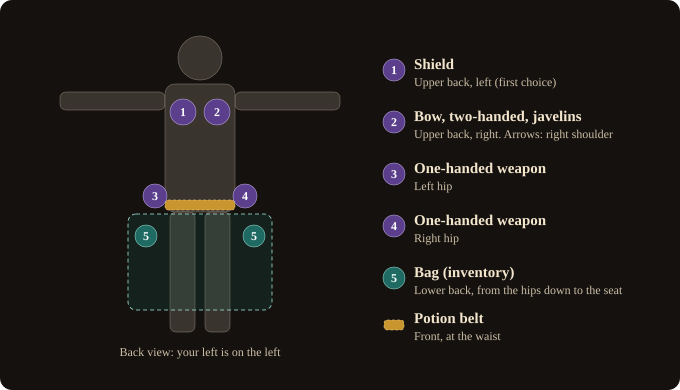

# The holster

Your two weapon sets and your shield hang on your body, at four places: both hips and both sides of your
upper back. Close your hand on a place to draw what hangs there; open your hand to put it away. Nothing to
open, nothing to click.

The holster is on by default (`[holster] enabled = yes` in `horadrim.ini`). With it off, nothing hangs on
you and you swap weapon sets by reaching over a shoulder and pressing the grip, as in d2r-pcvr.

## The four places

| Place | What it takes |
|---|---|
| Left hip, right hip | One-handed weapons, throwing knives and axes |
| Upper back, left | A shield goes here first; any back item if you put it there |
| Upper back, right | A bow, a two-handed weapon or javelins go here first, so they share the back with a shield |

- Bows, two-handed weapons, javelins and shields go on the **back only**. A one-handed weapon may go on
  the back too, if you put it there.
- **One place holds one item**, never one over another.
- **You choose the places.** Let an item go slowly at another free place and it hangs there from then on,
  in later games too. Let it go at a place that holds another item: the two trade places.

| Gesture | What happens |
|---|---|
| Close an empty hand on a place that holds a weapon | It is equipped in your hand again. If it belongs to the other weapon set, the game swaps sets by itself |
| Close your hand on a place while already holding a weapon | The one you hold goes to its place first, then the other comes |
| Open the hand that holds a weapon (about half a second) | It goes to the place where you let go if it is free, else back where it came from, else a free place |
| Open the hand at your lower back (the bag) | The weapon goes into your inventory |
| All four places taken | The weapon stays in your hand (the log says so) |

- A grip loosened in a fight does not put the weapon away: the hand must stay open 450 ms
  (`release_delay_ms`).
- A fast hand strikes or throws; it takes nothing on the way (`max_speed`).
- **Javelins**: opened fast, it is a throw. To put them away, lay them **slowly** on a back place.
- **A bow** with an arrow nocked stays in your hand.
- From the start of a game, what the holster holds hangs on you and can be drawn at once.

## Shields

A shield is strapped on, not gripped: it stays on your left arm whatever your hand does in a fight.

- **Put it away**: open your **left hand over a shoulder** (or at your lower back, into the inventory). It
  goes to a back place, the left one first. Opened anywhere else, the shield stays on your arm.
- **Draw it**: close **either hand** on its place: it comes back to your **left arm**.
- **A two-handed weapon or a bow drawn** with a shield on: the shield goes to a free back place first,
  then the weapon comes. No free back place: nothing moves, and the log says why.
- **Sword and shield**: a one-handed weapon in the right hand and the shield stay together.

## The quiver

- The bow's quiver goes with the bow: put the bow away and its quiver follows; draw the bow and the quiver
  is worn again in the other hand. You never manage it yourself.
- **It puts itself on** (`[bow] auto_quiver = yes`): whenever a bow (arrows) or a crossbow (bolts) is in
  hand and the other hand is empty, the holster's quiver goes on, else the first quiver of the right kind
  in your inventory. A quiver picked up while the bow is in hand goes on the same way; when the one you wear
  runs out, the next comes. Never the wrong kind, never over a shield or another weapon.

## What "put away" means

The holster is real: a weapon or shield put away **truly leaves your hand**. It goes into a page of the
mod's own, `horadrim.holster`, kept by D2RLoader with your character - never the inventory, never the
ground. Drawing it equips it again.

- A weapon put away **no longer gives its bonuses** (life, skills, aura), as in the game. Life lost when
  you put it away does not come back when you draw it again.
- Every move goes through the game's own local server and is **read back** right after.
- **A refusal is only a refusal.** When the game would not take a move, you feel a dull pulse and the log
  says why; nothing moved, and the next grab tries again. The holster never switches itself off for a
  refusal.
- The mod does nothing while a trade, stash, Cube or dialogue window is open (the inventory alone is
  fine), while your hero is dead, attacking or casting, just after an area change, or while an item is on
  the cursor.
- Only an item the mod loses track of counts as a failure; two in a session and the holster is off until
  the game starts again (the weapons then swap over the shoulder), both hands vibrate, and the log says
  where the items are.

### Before you rely on it

- **Try it on a throwaway character first**, offline.
- **Offline only**, a local game of one player. The mod checks this itself.
- **Nothing moves without a backup.** Your saves are copied at every start and after every save the game
  writes, into `<game folder>\d2rloader\plugins\horadrim\backups\` (the 20 newest are kept). If the start's
  copy fails, nothing moves.

## The Holster page in a wheel

Open a wheel (a stick click) and press the **sheathed sword** icon at its bottom left.

- The four places laid out as on your body: the back high, the hips low. For each: the item's icon and
  name, its weapon set (I or II), and *stowed (unequipped)* or *empty*. The bow's quiver shows with the bow
  (*+ quiver*).
- **Back to the inventory** under a place, **All back to the inventory** for everything: the item goes
  into your inventory in one move, never through the cursor, never on the ground. Inventory full: nothing
  moves and the page says so.
- **SHOW IN GAME** opens the holster's page in the game's own interface (below).

## The holster's page beside the inventory

When you open the inventory alone, the holster's page opens on its left, as the stash does: five blocks
(left hip, right hip, back right, back left, the quiver). The game draws the items and their tooltips.
**Ctrl-click** (hold the left trigger, click with the right trigger) sends an item back to the inventory.
`[holster] inventory_panel = no` stops it opening with the inventory. As with the stash, put down an item
held on the cursor before you close the inventory.

## Emptying the holster

Any of these puts everything in the page back into your inventory:

- a wheel's Holster page, **All back to the inventory**;
- D2RLoader's console: `horadrim holster empty` (`horadrim holster status` says what the page holds);
- the holster's page beside the inventory: Ctrl-click each item.

Emptying stops at the first item that does not fit in the inventory, and says so: make room and try
again. It works even when the holster was switched off for the session.

## Before uninstalling

The page belongs to the mod. **Without the mod, D2RLoader refuses to load a character whose holster page
still holds an item.** So, for every character that used the holster:

1. Load it in an offline game.
2. Empty the holster (above).
3. Check that `horadrim holster status` says the page holds nothing.
4. Leave the game: it saves the character with an empty page.
5. Only then uninstall, set `[holster] enabled = no`, or switch the launcher to D2R VR (natpoh).

The launcher's **Uninstall** (and its switch to D2R VR (natpoh)) lists the characters D2RLoader saved,
asks you to tick that their holsters are empty, and copies all your saves before it changes anything.

If a character no longer loads, install the mod again, empty its holster, then uninstall. Or go back to a
copy: close the game, and on the launcher's **Backups** page restore that character from the last backup
made before the problem.

## If your hero dies

The game's rule: the weapons and armour you **wear** go to your corpse; the inventory, the belt, the Cube,
the stash and **the holster's page** stay as they were. The mod watches the page through a death and the
log says, for each item it held, whether it is still there (`[holster] death_watch`). What the page holds
is also written to `d2rloader\plugins\horadrim\holster-page.txt` at each change.
