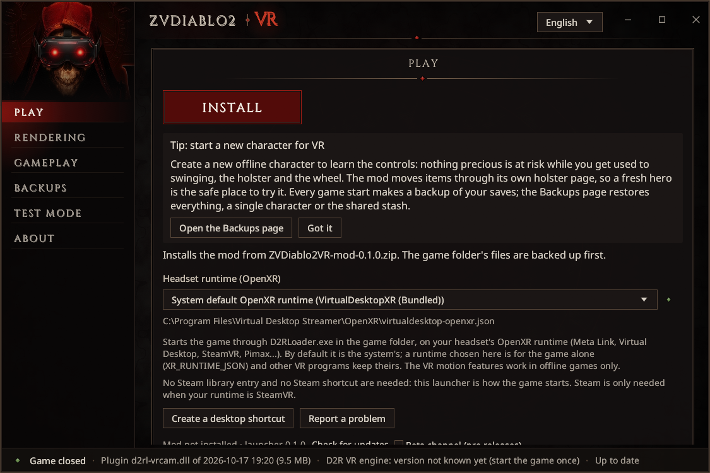
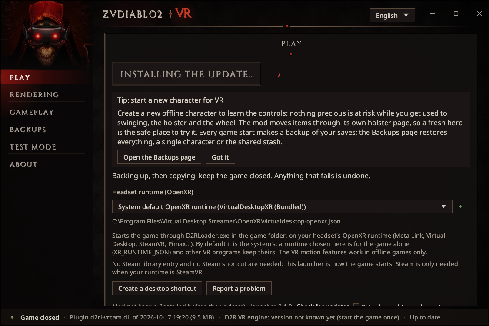
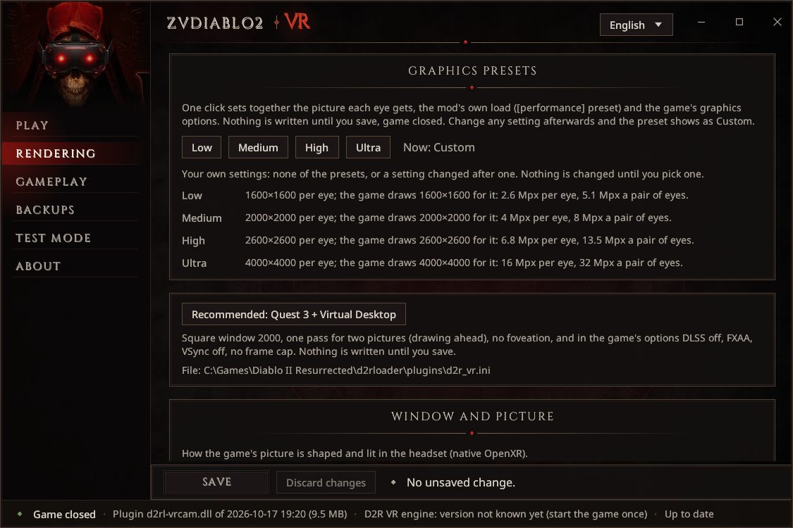
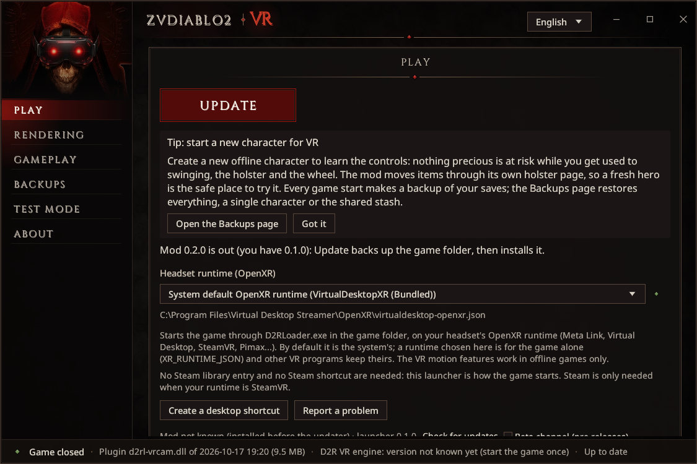
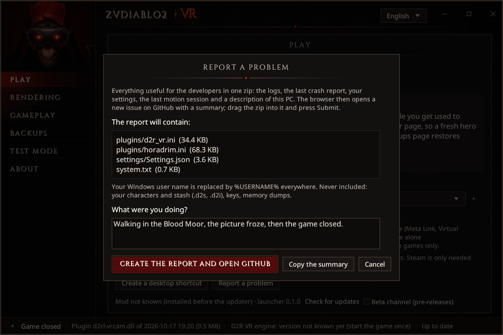
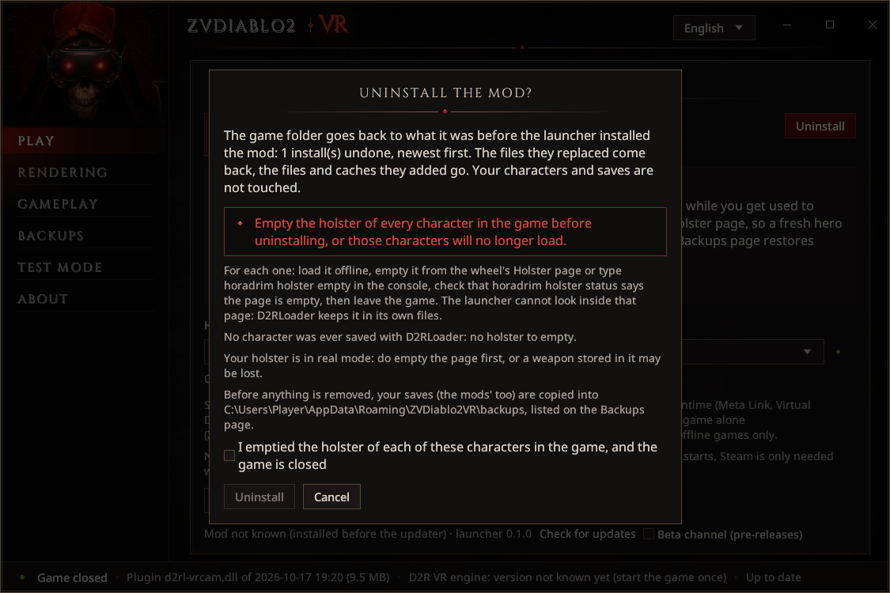

# Installing

ZVDiablo2VR is a plugin for [D2RLoader](https://d2rloader.net/), the game's mod loader. A small program,
the **launcher**, installs everything into your game folder, starts the game in VR, edits the settings,
keeps copies of your saves and takes everything away again when you uninstall. You never need to copy a
file by hand.

> **No release yet.** The downloads will be on the
> [Releases](https://github.com/Ztnzvoid/ZVDiablo2VR/releases) page with the first release. The steps
> below are ready for it. The source code comes with the first release too.

## 1. What you need

- **Windows 10 or 11, 64-bit**, and a graphics card for PC VR ([Performance](performance.md) says what
  each part costs).
- **Diablo II: Resurrected**, your own copy, from Battle.net or Steam, installed and **started once**
  (the game writes its video options the first time it quits). The mod is tested on game build
  3.3.93847; on another build, a feature whose game code is not recognised switches itself off and says
  so in the log.
- **A PC VR headset and its OpenXR runtime**, installed and working:

  | Headset | Runtime (the PC software) |
  |---|---|
  | Meta Quest 2, 3, 3S, Pro | Virtual Desktop (its Streamer), or Meta Link / Air Link (the Meta Quest Link app), or Steam Link with SteamVR |
  | Valve Index, Steam Frame, HTC Vive and other SteamVR headsets | SteamVR |
  | Pimax | Pimax Play (or SteamVR) |
  | Windows Mixed Reality | its OpenXR runtime, or SteamVR |

  Quest 3 with Virtual Desktop is what the mod is played with most. A standalone Quest cannot run it on
  its own: the game runs on your PC.
- **An internet connection during the install**, if the game folder has no D2RLoader yet: the launcher
  downloads it from its official site, after asking you.

You do **not** need Python, ReShade, BodyWalk, FlatVR, Steam (unless your runtime is SteamVR) or natpoh's
D2R VR installer: the mod's package brings what it is allowed to ship, and the launcher fetches the rest.

## 2. Get the launcher

1. From the [Releases](https://github.com/Ztnzvoid/ZVDiablo2VR/releases) page, download the launcher zip,
   `ZVDiablo2VR-launcher-<version>.zip`.
2. Unzip it into a folder of its own, for example `C:\Games\ZVDiablo2VR`.
3. Start `ZVDiablo2VR.exe`. The language switch is at the top right (English or French).

The launcher installs the newest mod release it finds on the Releases page by itself. If you prefer to
install offline, also download the mod zip, `ZVDiablo2VR-mod-<version>.zip`, and put it beside
`ZVDiablo2VR.exe` (or choose it under **Install details** on the Play page): every file in it is checked
against its checksums before anything is copied.

## 3. Find the game folder

The launcher looks for the game in the usual places. Under **Game folder** on the Play page it says what
it found:

- *"D2R.exe found, but no D2RLoader.exe: install ZVDiablo2VR first"* - the right folder, ready for
  step 4;
- *"This is not a Diablo II: Resurrected folder"* - type the path of your game folder (for example
  `C:\Games\Diablo II Resurrected`), or press **Detect**.

## 4. Install

Press the big **INSTALL** button on the **Play** page. The text under it says which package it will
install.

What happens, in order:

1. **D2RLoader, with your consent.** If the game folder has no D2RLoader, a window asks *"Download
   D2RLoader?"*. It shows where the file comes from (d2rloader.net), its version, its size and its
   checksum. D2RLoader is made by its own author and is not ours to ship, so the launcher fetches the
   official archive and checks it before installing anything. Press **Download and install**, or **Not
   now** to stop there, or **Open d2rloader.net** to get it yourself. Some antivirus programs flag mod
   loaders as "potentially unwanted": if the download is blocked, get D2RLoader from its site. Its files
   are recorded like the mod's, so Uninstall takes them away again.
2. **A backup of everything the install replaces**, before anything is copied. If any step fails,
   everything is undone.
3. **The mod**: the plugin, its settings templates, its private Python, the sky pictures and the
   licences. If you already have settings files, they keep every value you set: only missing settings
   are added.
4. **The Microsoft Visual C++ runtime**, only if Windows lacks it (D2RLoader needs it). It comes from the
   mod's package; Windows asks your permission. If the launcher then says so, restart Windows before you
   play. Refused or failed, the Play page offers **Download it from Microsoft…**.
5. **The caches**, built from your own game: the weapons, quivers and potions you hold and the skill
   icons of the wheel are read from your installation. A few minutes the first time. These files stay on
   your PC: never share them.
6. **What would load beside the mod is set aside**, never deleted: natpoh's own D2R VR plugin and its
   settings, ReShade, an older version's plugin. They go to `d2rloader\zvd2vr-aside\` in the game folder,
   and **Install details** lists them before you install. BodyWalk and FlatVR are not touched.

When it is done, the big button says **PLAY**.

**Already had natpoh's D2R VR?** It is kept, with its own settings and ReShade. The Play page then shows
**VR setup PLAY starts**: *ZVDiablo2VR* (the default) or *D2R VR (natpoh)*. Switching asks first, game
closed, and only moves files. **Do not run the old D2R VR uninstaller** (`unins000.exe` in the game folder,
or "D2R VR" in Windows' installed apps): it would remove files this installation needs. Use the launcher's
**Uninstall** instead.

## 5. Choose the picture

On the **Rendering** page, pick a **graphics preset**: **Low**, **Medium**, **High** or **Ultra**. One
click sets the picture each eye gets (1600, 2000, 2600 or 4000 pixels a side), the mod's own load and the
game's graphics options, with what VR needs on top (no DLSS, VSync off, no frame cap, FXAA - SMAA for
Ultra). **Recommended: Quest 3 + Virtual Desktop** is a good start for that headset. Press **Save**:
rendering settings are saved only while the game is closed. [Performance](performance.md) says which
preset fits which card.

## 6. First start

1. Start your headset's software (Virtual Desktop: connect the headset to the PC first; SteamVR: start
   SteamVR).
2. On the Play page, check **Headset runtime (OpenXR)**. The system's default is usually right: it is the
   runtime your headset software declared. You can also pick any installed runtime, or **Browse for a
   runtime JSON…**: a choice made here is for this game only, other VR programs keep theirs.
3. Press **PLAY**. The launcher saves any pending setting, then starts the game through D2RLoader. No
   Steam library entry or Steam shortcut is needed.
4. Put the headset on.
   - **The controls screen** shows your own controllers' buttons, the places on your body and the wheels.
     Push a stick left or right for its pages; any button or trigger closes it. Both stick clicks held
     together for a second show it again in the game.
   - **The body calibration** is asked at the first start: stand straight, arms out to the sides (a T),
     release both triggers, then squeeze and hold both until *Saved*. Your height sets the world's scale
     and your arm span fits your hero's arms; the holster places follow your size.
5. **Load an offline character** - a new one, see below.

### Start with a new character

Create a **new offline character** (or play a copy of one you do not mind losing) for your first sessions:

- the gestures take a little practice, and a fresh Act 1 is the place to learn them;
- the holster, the 3D bag and picking up by hand move items through the game's own functions. Every move
  is checked and your saves are copied before anything moves, but this is a first release: keep your
  treasured characters away until you trust it.

The launcher shows this tip on the Play page until you close it.

### Offline only

The motion features work in **offline games only** - the code checks it before anything acts on the
game. **Never start the game with this mod for Battle.net play**: third-party code in online games is
against Blizzard's rules and puts your account at risk.

## The desktop shortcut

**Create a desktop shortcut** (Play page) puts a "ZVDiablo2VR" shortcut to the launcher on your desktop.
Start the game from it, never from Battle.net or Steam (they start the game without the mod).

## Updates

The launcher looks for a new version once a day and when you press **Check for updates**. When one is
out, the big button says **UPDATE**, with the release notes under it; a new launcher has its own card.

Every update is checked (SHA-256) before anything is touched, installs only with the game closed, backs
up every file it replaces into `%APPDATA%\ZVDiablo2VR\updates\backups\`, and keeps the values of your
settings files (only new settings are added). **Roll back to …** under **Install details** undoes the last
update of the mod. Tick **Beta channel (pre-releases)** to be offered test versions too.

## Backups

Your saves are copied **at every start of the game and after every save the game writes**, into
`<game folder>\d2rloader\plugins\horadrim\backups\` (the 20 newest are kept). Nothing moves an item if the
start's copy failed.

The launcher's **Backups** page lists those copies, the launcher's own copies (before an uninstall or a
restore) and any copy you put in `%APPDATA%\ZVDiablo2VR\backups\` yourself. **Restore…**, game closed,
offers:

- **everything in this backup**;
- **one character** (its `.d2s` and the files beside it);
- **the shared stash only**.

Your current saves are always copied aside first (into `Saved Games\ZVDiablo2VR - saves before restore\`,
listed on the same page), so a restore can be undone. Nothing is deleted. **Make room…** shows the biggest
folders old recordings and copies take; the launcher never deletes them itself.

## Report a problem

**Report a problem** (Play page, and the About page) gathers into one zip everything useful to the
developers: the mod's logs, the last crash report, your settings files, the game's video options and a
description of your PC (Windows, processor, memory, graphics card and driver, headset runtime, versions).
Your Windows user name is replaced by `%USERNAME%` everywhere; your characters, stash, keys and memory
dumps are never included. The list of files is shown first.

1. Say in a few words what you were doing and what happened.
2. Press **Create the report and open GitHub**. Your browser opens the project's crash form with a summary
   filled in, and Explorer shows the zip.
3. Say which headset and runtime you use, **drag the zip into the form**, and press **Submit**.

If the game the launcher started crashes or hangs, the launcher offers a report by itself when it closes.
Without the launcher, use the [bug form](https://github.com/Ztnzvoid/ZVDiablo2VR/issues/new?template=bug.yml)
and attach `<game folder>\d2rloader\logs\d2r-vr-frame.log`. Never post saves, game files or account
details.

## Uninstalling

**First, empty the holster of every character that used it.** A weapon or shield put away in the holster
lives in a page of the mod's own; without the mod, D2RLoader refuses to load a character whose holster
page still holds something. For each character:

1. Load it in an offline game.
2. Open a wheel (a stick click), press the **sheathed sword** icon (the Holster page), then **All back to
   the inventory**. Or type `horadrim holster empty` in D2RLoader's console.
3. `horadrim holster status` should say the page holds nothing.
4. Leave the game: it saves the character with an empty page.

See [The holster](holster.md#emptying-the-holster).

Then, game closed, press the small red **Uninstall** at the top right of the Play page. The launcher:

- lists the characters D2RLoader saved, which may have something in their holster, and asks you to tick
  that you emptied them and that the game is closed;
- copies all your saves (the mods' saves too) into `%APPDATA%\ZVDiablo2VR\backups\<date> before uninstall\`;
  if that copy fails, nothing is uninstalled;
- undoes every install it made, newest first: the files they replaced come back, the files and caches
  they added go, D2RLoader too if the launcher installed it, and whatever it set aside (natpoh's D2R VR,
  ReShade) comes back as it was.

Your characters and saves are not touched.

