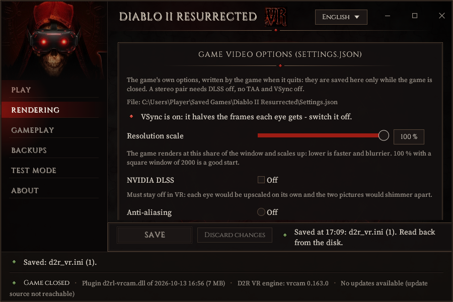
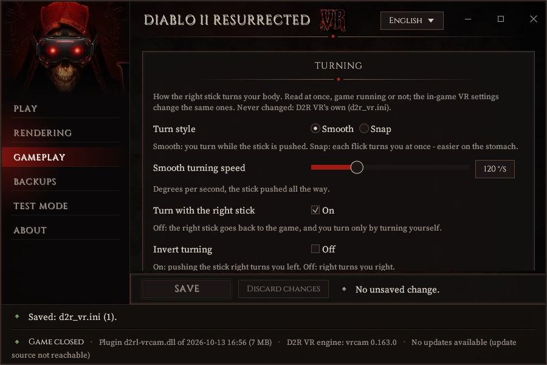
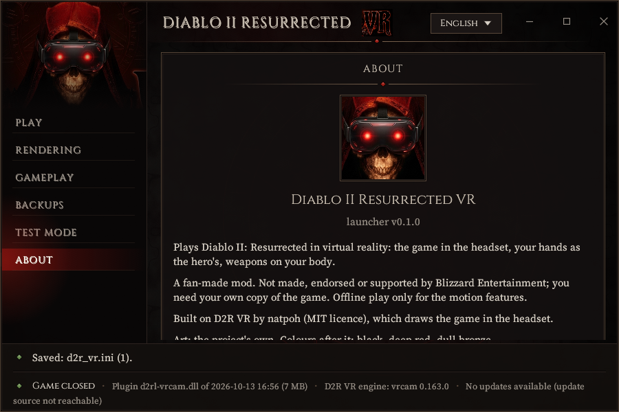

# Settings

You never need to open a file: the launcher edits the settings that matter, with a help line for each.
Every setting is also explained in its own comment in its file.

| File | Whose | What | When it is read |
|---|---|---|---|
| `<game folder>\d2rloader\plugins\horadrim.ini` | this mod | gestures, holster, bag, bow, crossbow, throwing, spells, belt, pick-up, wrist, wheels, controls, dialogue, room-scale, turning, language, picture fixes, performance tier | again within 2 seconds of a save, game running or not |
| `<game folder>\d2rloader\plugins\d2r_vr.ini` | natpoh's D2R VR engine | the picture size, stereo, fog, sky, HUD, the body calibration | when the game starts (save it with the game closed) |
| The game's `Settings.json` (`Saved Games\Diablo II Resurrected`) | the game | its video options | when the game starts; the game writes it back when it quits |

If `horadrim.ini` goes missing, the mod writes it again at the next start with every default. An older
file with French names (`[etui]`, `oui` / `non`) still works; the launcher converts it to the English names
the first time it saves, keeping your values and comments (the old file as `horadrim.ini.before-english.bak`).

## The launcher's pages

The pages are in the left column. Each settings page has a bar at the bottom: *N unsaved change(s)* or
*Saved*, with **Save** and **Discard changes**; a page with changes waiting has a red dot. **PLAY** saves
what is pending before it starts the game. Before its first write to a file the launcher keeps a copy
beside it (`*.before-launcher.bak`), and it changes only the lines you changed, comments included.

**Play.** Install, update and uninstall; the game folder; the headset runtime; **Create a desktop
shortcut**; **Report a problem**; **Check for updates** and the beta channel; **Install details** (where the
package comes from, the caches, what the launcher installed, **Roll back to …**, the install log). See
[Installing](install.md).

**Rendering.** First the **Graphics presets** card: **Low**, **Medium**, **High**, **Ultra** set in one
click the picture each eye gets (1600, 2000, 2600, 4000 a side), the mod's `[performance] preset` and the
game's graphics options, with what VR needs on top; it says **Custom** once you change a setting after it.
**Recommended: Quest 3 + Virtual Desktop** fills in a good start for that headset. Then, setting by
setting: the square game window and its size per eye, brightness, the window's shape, labels in both eyes,
the performance mode (one pass, two pictures) and its pacing, foveated rendering, the rings of rooms and
the draw distance, the game interface out of the picture, the item labels' depth, and the game's own video
options. **Anti-aliasing** puts the game's anti-aliasing and its DLSS in one choice, each with its cost:
Off, FXAA (recommended), SMAA, TAA (not for VR) and the DLSS modes (untested in VR; D2R has no DLAA).
Rendering settings are saved **only with the game closed**: D2R VR reads them at the start and the game
writes its options back when it quits. See [Performance](performance.md).

**Gameplay.** Every section of `horadrim.ini`, in its order, with a switch, a choice or a slider for each
setting and a help line: the holster, the bow, throwing, the weapon weight, vibration, the keyboard, the
belt, the light on held items, the wheel, picking up by hand, turning, Valve Index controllers, and all the
others. **Back to the defaults** resets the page. Saved even while you play: the mod reads the file again
within 2 seconds.

**Backups.** The copies of your saves and **Restore…** (everything, one character, or the shared stash).
See [Installing](install.md#backups).

**Test mode.** For developers (a simulated headset). Leave it alone.

**About.** Versions, credits, and **Report a problem**.

## Settings worth knowing

All in `horadrim.ini` unless said otherwise.

| Setting | Default | What it changes |
|---|---|---|
| `[controls] layout` | `buttons` | `classic`: the layout before 2026-10-16 (hold Y or B for the wheels, the left stick click to run, quick casts on the left trigger + a face button). See [CONTROLS.md](../../CONTROLS.md#classic-layout-controls-layout--classic) |
| `[controls] stick_long_press_ms` | 500 | How long a stick click is held to open the game's menu instead of a wheel |
| `[melee] min_speed` | 2.0 | m/s of the weapon's tip for a blow. Higher: more deliberate blows |
| `[melee] attack_speed` | `yes` | The game's own attack pace for your class, weapon and IAS. `no`: a fixed pace by weapon kind |
| `[weight] hit_stop_ms`, `push_back_cm` | 120, 6 | The stop and the push back when a blow lands (0: none) |
| `[haptics] strength` | 1.0 | Every vibration multiplied by this (0 to 2) |
| `[holster] enabled` | `yes` | `no`: nothing hangs on you; weapons swap over the shoulder. Empty the holster first ([The holster](holster.md)) |
| `[holster] inventory_panel` | `yes` | `no`: the holster's page no longer opens beside the inventory |
| `[bow] auto_quiver` | `yes` | `no`: you put a quiver on by hand in the game's inventory |
| `[crossbow] cocking` | `flick` | `string`: the left hand pulls the string back; `off`: no cocking, the trigger held shoots at the game's pace |
| `[throw] gesture` | `grip` | `trigger`: hold and release the trigger to throw |
| `[spells] aim_ray` | `no` | `yes`: a thin ray from the casting hand while you aim |
| `[spells] move_speed_while_casting` | 0.6 | How fast you go while casting on the move (0.3 to 0.95) |
| `[pickup] reach`, `height` | 0.55, 0.95 | How far from an item (m) and how high above the ground a hand can take it |
| `[pickup] button_picks_up` | `no` | `yes`: the game's A button picks items up again |
| `[gravity] enabled` | `no` | `yes`: point at an item up to 2 m ahead, grip and flick it into your hand |
| `[bag] enabled` | `yes` | `no`: no 3D bag |
| `[bag] let_go_closes` | `yes` | `no`: the bag stays in your hand until you put it behind your back |
| `[bag] drop` | `yes` | `no`: an item let go outside the bag comes back instead of being dropped |
| `[belt] distance_cm`, `potion_size_cm`, `spacing_cm` | 10, 12, 8.6 | Where the potions hang and how big they are drawn |
| `[wrist] stats_style` | `bars` | `orbs`: the old flat picture with two orbs |
| `[wrist] map_orientation` | `north` | `player`: where you look is up |
| `[roomscale] enabled` | `yes` | `no`: your steps no longer walk the hero |
| `[turn] mode`, `snap_degrees`, `smooth_speed` | empty (D2R VR's own: snap 30 degrees) | `smooth` or `snap`; the launcher's Gameplay page, **Turning**, sets them |
| `[welcome] enabled`, `every_start` | `yes`, `yes` | The controls screen at the start; `every_start = no`: once, then only when it changes |
| `[dialogue] style` | `box` | `text`: the letters alone; `game`: the flat picture |
| `[keyboard] layout` | `azerty` | `qwerty` |
| `[interface] language` | `auto` | The mod's own words: the game's language (French or English); `en` or `fr` forces one |
| `[wheel] style` | `tiles` | `plain` (a disc) or `panel` (a square, like the game's) |
| `[index] squeeze`, `release` | 0.25, 0.5 | Valve Index: how hard to squeeze to take, how far to open to let go |
| `[render] vr_window` | `square` | D2R VR's square window. `wide`: a 16:9 window, each eye its middle square |
| `[render] panels_in_room` | `yes` | `no`: the game's panels on the flat picture |
| `[render] xr_layers_off` | empty | Keeps OpenXR add-ons installed for other games out of D2R ([Troubleshooting](troubleshooting.md#the-picture)) |
| `[performance] preset` | `auto` | `low`, `medium`, `high`, `ultra`. See [Performance](performance.md) |
| `[debug] diagnostics` | `off` | `on`: the detailed measuring lines in the log (leave it off to play) |

In `d2r_vr.ini` (natpoh's engine): `[openxr] window_size` (the picture per eye; the launcher's
**Headset resolution per eye**), `[calibration] version = 0` (the body calibration asked again at the next
start), `[interactions] dominant_hand` (the hand for the over-the-shoulder weapon swap when the holster is
off).
